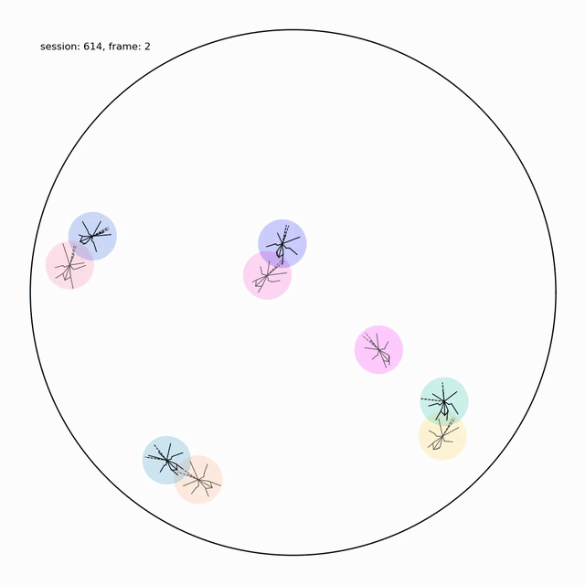
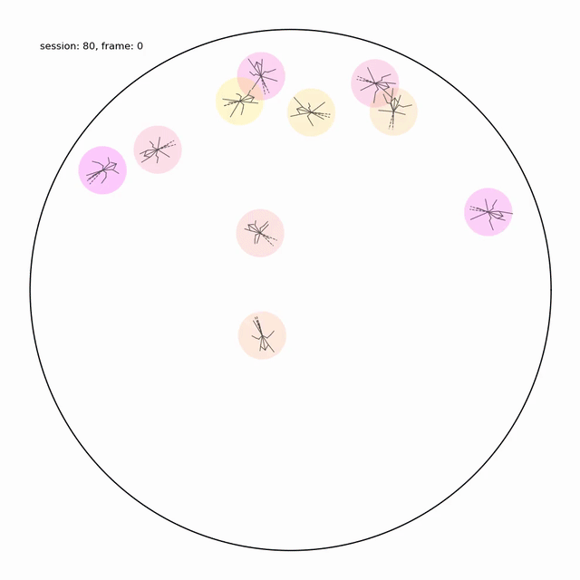
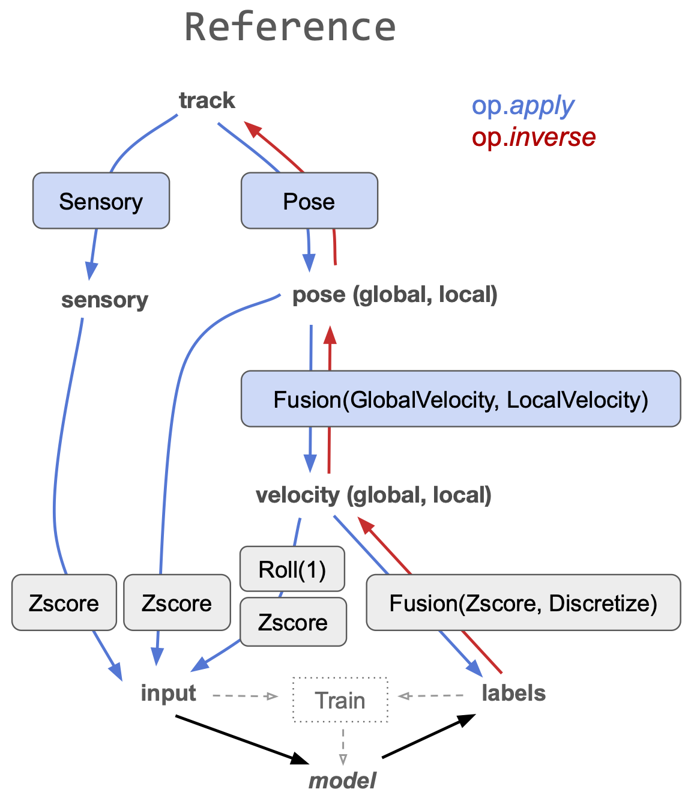
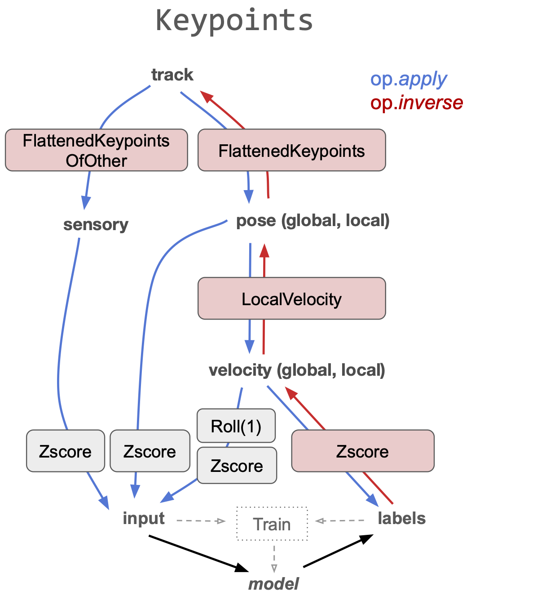
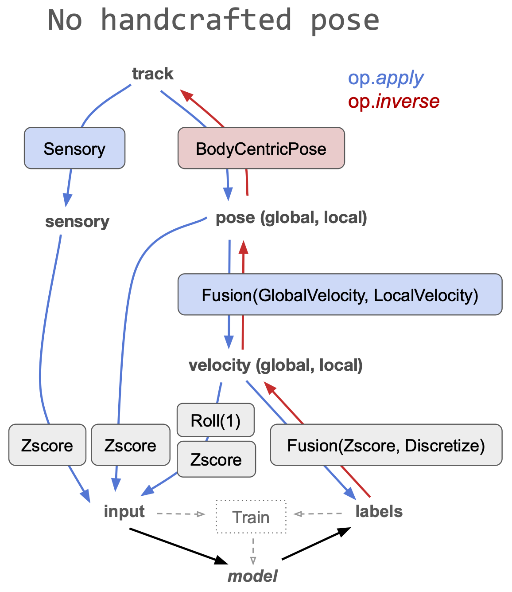
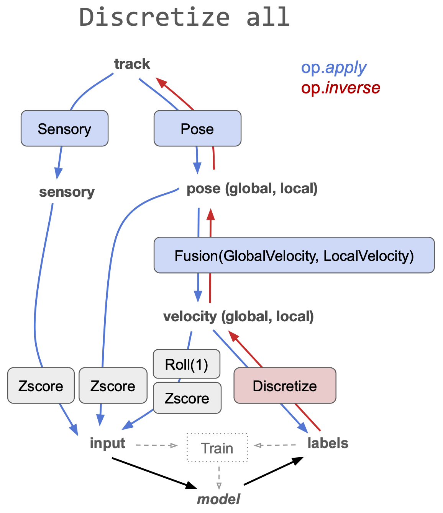
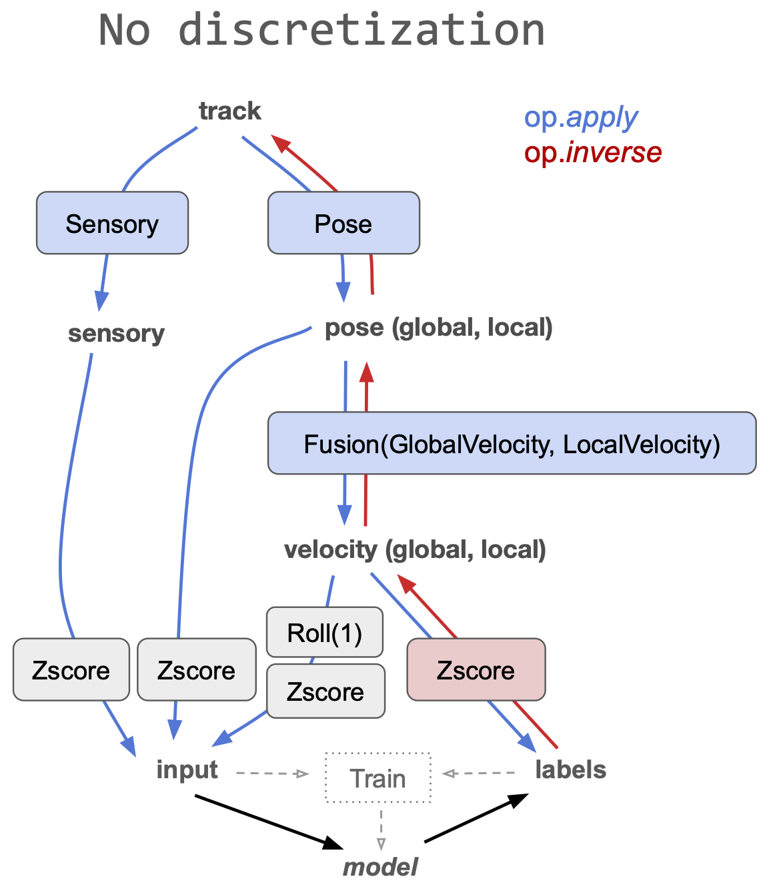
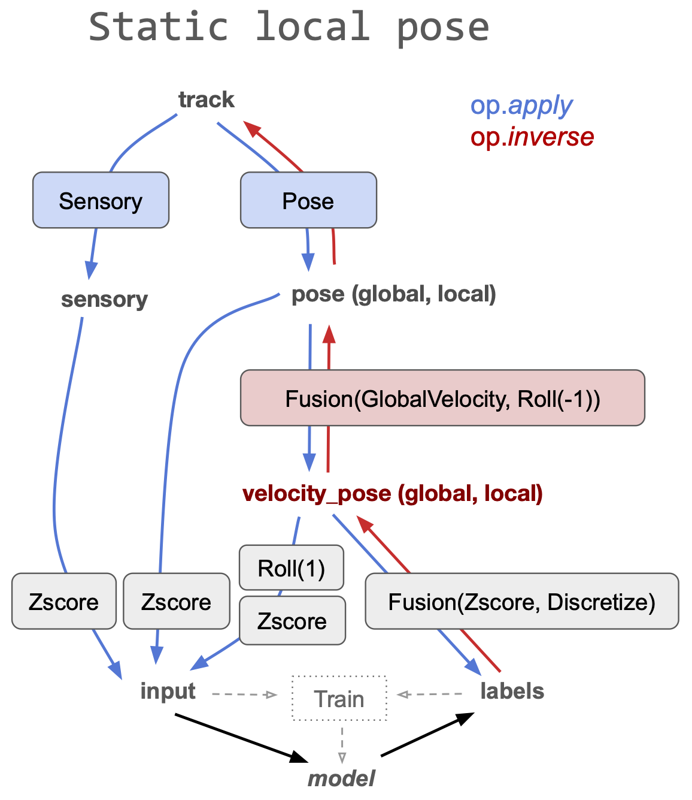
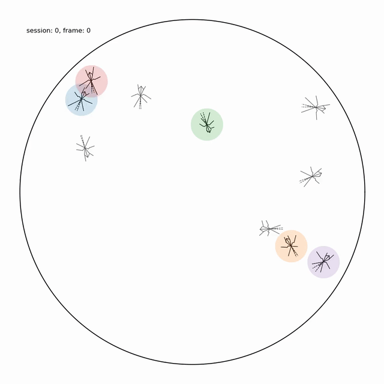
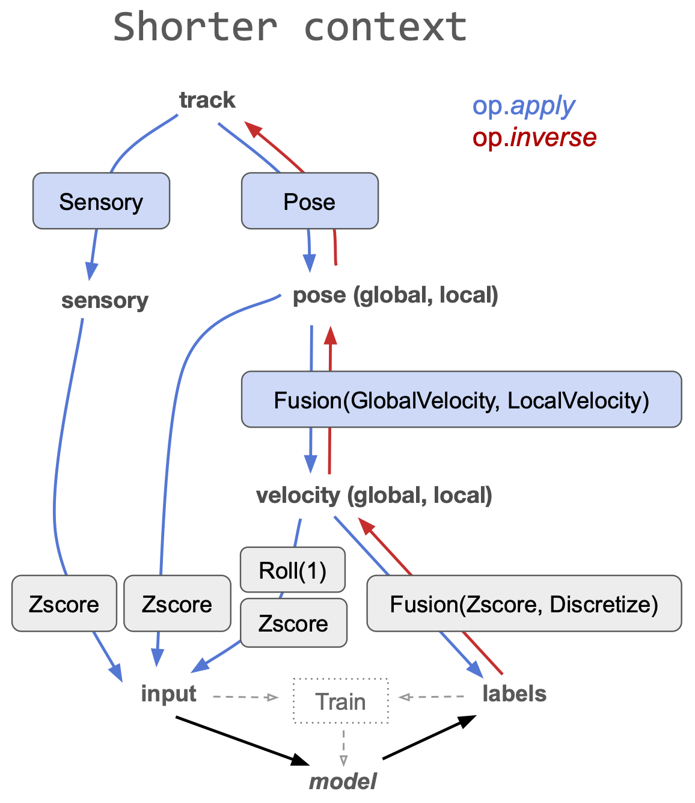

# Animal Pose Forecasting Library

| **Real trajectories** | **Agent-centric simulation** |
|:---:|:---:|
|  |  |

> 🚧👷‍♀️ **Under construction** — this library and its documentation are a work in progress. 🏗️🚧

The Animal Pose Forecasting library (APF) contains code for training, simulating from, and evaluating **agent-centric** autoregressive models of **animal behavior** from tracked **pose**. Unlike standard world-frame approaches, agent-centric models input egocentric sensory observations and output egocentric movements, mirroring the biological constraint that animals observe and act on the world from their own reference frame. Social behavior emerges from agents independently sensing and responding to one another. 

This Python and PyTorch-based library is built around the observation that, to train and generate from agent-centric models, the **same data** needs to be available in **many representations**: world-frame, egocentric, sensory, ML-friendly. Translating between these representations requires **composing sequences of operations** or their inverses. Our library makes these operations explicit, manipulable objects that are composable, invertible, and serializable alongside the model. The sequence of operations applied to a chunk of data is itself stored, so the library knows how a given representation was constructed and can invert or serialize it on demand.


## Model variants

For each variant, the flow diagram (left) shows how data is transformed, and the GIF (right) shows a simulation from that model. Colored circles highlight simulated male flies; non-highlighted flies are real female flies. 

| Operations | Simulation |
|:---:|:---:|
|  |  |
|  |  |
|  |  |
|  |  |
|  |  |
|  |  |
|  |  |


## How to run some things

### Launching a dataset-cache build job

Preprocessing the data takes over an hour and doesn't need a GPU.  So build the cache on a CPU node first, and training jobs will just load it.  Using any Python environment with AnimalPoseForecasting installed:

```bash
python -m flyllm.launch_build_dataset_cache <config>.json
```

- Its defaults fit the female config: the `local` CPU queue, 16 slots (240 GB) and a 6 h limit.
  - The last build took 84 min and peaked at 161 GB of memory.
  - Use `-n` for more slots, `-q` for another queue and `-W` for another time limit.
- The cache file goes in the config's `dataset_cache_dir`.  Make sure that's set to a directory you can write to; `/nrs` is a good place.
  - The file is named after the data-related config settings.  If a matching cache already exists, the job finishes right away without doing anything.
- Logs go in `--outdir`.  The default is a new numbered directory under `./runs/`.
- As with training, the job runs with the same `python` you launch it with.  So that environment must be on a filesystem the compute nodes can see.
- **When you need a new cache:** only when you change settings that affect the data, such as the data files, `categories`, features or binning.
  - Changing model or training settings (learning rate, epochs, GPU count, etc.) reuses the existing cache.
  - If a training run can't find its cache, it builds one itself, but that uses up GPU time.


### Launching a multi-GPU training run job

Using any Python environment with AnimalPoseForecasting installed, run this from the directory where you want the run's output:

```bash
python -m flyllm.launch_train <config>.json -q gpu_h100 --gpus 4 -n 48 \
    --outdir runs/<run name> \
    --overrideconfig '{"lr_gpu_scaling": "linear", "num_warmup_epochs": 4}'
```

- The launcher submits the job with the same python you run it with. So that environment needs to be on a filesystem the compute nodes can see, such as /groups or /nrs, not a local disk.
- `--gpus N` sets the number of GPUs, one training process each.
  - Each GPU gets its own batch of batch_size samples, so the effective batch is N × batch_size.
  - The default is 1 GPU in gpu_a100.
- `-n` is the number of slots. Use 12 per GPU, so 48 for 4 GPUs.
- "lr_gpu_scaling": "linear" multiplies the learning rate by N. The default is "sqrt", which multiplies by √N, so you have to set this.
  - With linear scaling, 4 GPUs reach the same loss per epoch as 1 GPU. That makes the run about 3.8× faster in wall time.
- "num_warmup_epochs": 4 ramps the learning rate up over the first 4 epochs. The default is 0.
  - You need warmup with linear scaling. Without it, the higher learning rate gets stuck on an early plateau and never recovers.
- Everything the run writes goes in --outdir: logs, models and figures. That directory must not already exist. The default is a new numbered directory under ./runs/.
- You can also put "lr_gpu_scaling" and "num_warmup_epochs" in the config instead of passing --overrideconfig.

On H100s, 200 epochs takes about 6.5 h on 1 GPU and about 1.7 h on 4. Validation loss bottoms out around epoch 150–200.


## Credits

Library developed by [Eyrun Eyjolfsdottir](https://github.com/eyrun) and [Kristin Branson](https://github.com/kristinbranson)
